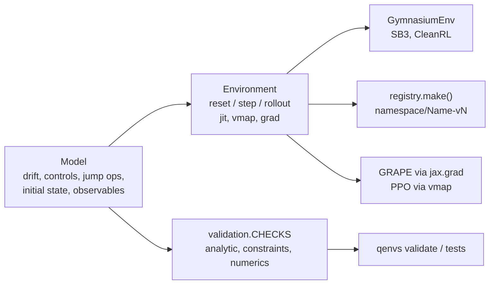

<p align="center">
  
</p>

**Physically validated quantum control environments for reinforcement learning and optimal control.**

*Reusable physics. Reproducible control.*

[](https://github.com/beomdo-park/QEnvS/actions/workflows/ci.yml)
[](https://beomdo-park.github.io/QEnvS)
[](https://pypi.org/project/qenvs/)
[](https://doi.org/10.5281/zenodo.23359969)
[](LICENSE)
[](https://github.com/astral-sh/ruff)

QEnvS (Quantum Environment Suite) is a model zoo of open-quantum-system control
problems (transmon gates, quantum batteries, qubit and three-level state transfer;
thermal machines later), packaged so
that you can plug them into an RL agent or a gradient-based optimiser in a few
lines, instead of re-deriving the physics for every paper.

Every model ships with **model-specific reference results that run as tests**
(pi-pulse inversion, exponential decay, ergotropy bounds, collective-charging
scaling, ...). The checks combine closed-form results, physical constraints and
solver convergence. Models are also cross-checked against QuTiP where an equivalent
independent formulation is available; the table below lists the exact coverage.

Built on [dynamiqs](https://github.com/dynamiqs/dynamiqs) (JAX): environments are
`jit`-able, `vmap`-able across thousands of trajectories, and differentiable, so
the same model serves RL (PPO/SAC), GRAPE-style optimal control and MPC.

## Install

Full instructions, GPU setup and troubleshooting: [Getting started](https://beomdo-park.github.io/QEnvS/getting-started/). Supported versions and the API stability policy: [Stability and versioning](https://beomdo-park.github.io/QEnvS/stability/).

```bash
pip install qenvs            # core: jax + dynamiqs
pip install 'qenvs[gym]'     # + gymnasium adapter (stable-baselines3, CleanRL, ...)
```

Since 0.3.2 the package also has explicit battery subsystems for custom models and endpoint
trajectory diagnostics
([custom models](https://beomdo-park.github.io/QEnvS/guides/custom-models/),
[trajectory API](https://beomdo-park.github.io/QEnvS/api/trajectories/)).

## Quickstart

Functional JAX API (batch 1024 episodes on one GPU):

```python
import jax, jax.numpy as jnp
import qenvs

env = qenvs.make("qubit/StateTransfer-v0", horizon=10, dt=0.2)

keys = jax.random.split(jax.random.PRNGKey(0), 1024)
states, ts = jax.vmap(env.reset)(keys)
actions = jnp.ones((1024, env.action_dim))
states, ts = jax.jit(jax.vmap(env.step))(states, actions)
print(ts.reward.shape, ts.info["fidelity"].shape)  # (1024,) (1024,)
```

Gradient-based control through the same environment:

```python
def loss(actions):
    _, rewards = env.rollout(actions)
    return -rewards.sum()  # = -(F_final - F_initial)


grad = jax.grad(loss)(jnp.zeros((env.horizon, env.action_dim)))
```

Gymnasium for classic RL libraries:

```python
from qenvs.wrappers import GymnasiumEnv
from stable_baselines3 import PPO

gym_env = GymnasiumEnv(env)
PPO("MlpPolicy", gym_env).learn(20_000)
```

Command line, for humans and coding agents (every command has `--json`;
`uvx qenvs ...` works without installing):

```bash
qenvs list --json
qenvs info qubit/StateTransfer-v0 --json       # physics, kwargs, references, usage
qenvs run qubit/StateTransfer-v0 --policy pi-pulse --set gamma1=0.1 --json
qenvs validate                                  # per-check error vs tolerance + versions
qenvs doctor                                    # install / backend / optional extras check
```

Repository conventions for coding agents are in [AGENTS.md](AGENTS.md); an LLM
index of the docs is at [`/llms.txt`](https://beomdo-park.github.io/QEnvS/llms.txt).

## Architecture



The physics lives only in `Model`; everything above it is an adapter. A model is
merged only with model-specific checks in `qenvs.validation` that compare it against
closed-form results, physical constraints and solver convergence, with QuTiP
cross-checks where an equivalent independent formulation is available.

## Models and tasks

| Task id | Model | Dissipation | Validated against | Status |
|---|---|---|---|---|
| `transmon/XGate-v0`, `transmon/SXGate-v0` | multi-level transmon (anharmonicity, I/Q drive, RWA) in hardware units (ns, rad/ns; kwargs in GHz and us) | optional T1, T2 (Lindblad; superoperator gate fidelity) | qubit limit, Rabi units, drift spectrum, gate-fidelity closed forms, idle T1/T2 fidelity, harmonic T1 ladder, CPTP superoperator, DRAG coefficient confirmed numerically, QuTiP cross-check, solver convergence | available |
| `transmon/CRGate-v0` | two coupled transmons (Duffing, exchange coupling J, common frame at the target frequency), CR drive on the control and a cancellation drive on the target; target ZX(pi/2) on the computational subspace | optional T1, T2 on both transmons | J = 0 decoupling, single-transmon limits, static ZZ at second order, first-order ZX rate at weak drive, frame change, CPTP superoperator, leakage-aware subspace fidelity, QuTiP cross-check, solver convergence | available (0.3) |
| `qubit/StateTransfer-v0` | driven qubit | T1, T_phi (Lindblad) | Rabi formula, pi-pulse, T1/T_phi decay, ergotropy, energy conservation, rho constraints, solver convergence | available |
| `battery/TwoLevel-v0` | open qubit battery (`QubitBattery`) | thermal bath (T1, n_th), T_phi | thermal steady state and stationary Gibbs state, pi-pulse energy = ergotropy = omega0, charging-power bound, QuTiP cross-check, rho constraints, solver convergence | available |
| `battery/Dicke-v0` | N cells + cavity (Tavis-Cummings / Dicke, symmetric subspace) | cavity loss, collective emission and dephasing | Jaynes-Cummings Rabi formula, excitation conservation, collective charging scaling (Ferraro 2018), RWA vs counter-rotating terms, QuTiP cross-check, rho constraints, operator algebra | available |
| `battery/DickeLocal-v0` | N cells + cavity with dissipation on every cell (permutation-invariant method, all spin sectors) | local emission, dephasing and pumping, plus the collective channels of `battery/Dicke-v0` | brute-force 2^N simulation to 1e-8, collective-only limit equals `battery/Dicke-v0`, QuTiP PIQS cross-check, single-cell dissipators, local relaxation and pumping closed forms, rho constraints | available (0.3) |
| `transfer/LambdaSTIRAP-v0` | three-level Lambda (pump + Stokes) | spontaneous emission from the excited level | dark state, two-level Rabi limit, STIRAP transfer (P3 > 0.99, P2 < 0.05), intuitive-order and diabatic counterexamples, emission robustness, QuTiP cross-check | available |

Each model has a page under `docs/models/` with its Hamiltonian, assumptions and validation table.

Realistic RL conditions (0.3): `ParameterRandomization` draws model parameters per episode,
`ControlErrors` adds gain, offset and step noise, `ObservationModel` (or
`qenvs.make(task, observation=..., shots=...)`) gives expectation-value observations with
exact finite-shot noise, and `qenvs.robust.evaluate` reports mean and lower-tail performance
over a parameter distribution
([uncertainty](https://beomdo-park.github.io/QEnvS/guides/uncertainty/),
[observation and evaluation](https://beomdo-park.github.io/QEnvS/guides/observation-and-evaluation/)).

Bring your own system: `HamiltonianModel.from_operators(drift, controls, jump_ops, initial_state)`
accepts NumPy, JAX, dynamiqs or QuTiP operators, plugs into every environment, and
`qenvs validate --model my_module:MODEL` runs generic physics and numerics checks on it
([guide](https://beomdo-park.github.io/QEnvS/guides/custom-models/)). For RL libraries,
`GymnasiumEnv(env, normalize_actions=True)` and the batched `GymnasiumVectorEnv`
([guide](https://beomdo-park.github.io/QEnvS/guides/rl-libraries/)). For hardware toolchains,
`qenvs.pulses` stores pulses with units and provenance (JSON, NPZ), resamples them exactly
to an AWG sample period and converts rad/ns to MHz
([guide](https://beomdo-park.github.io/QEnvS/guides/pulses/)). See the [roadmap](docs/roadmap.md).

## Baselines

`examples/grape_jax.py` (open-loop Adam, GRAPE-style, through `env.rollout`),
`examples/ppo_jax.py` (vectorised PPO, equinox + optax) and `examples/benchmark.py`
(table in [docs/benchmarks.md](docs/benchmarks.md)). Closed `qubit/StateTransfer-v0`,
3 seeds, about a minute on CPU: GRAPE 1.0000, PPO 0.9997 +- 0.0002 (optimum 1.0).

`examples/benchmark_battery.py` charges the battery tasks and compares GRAPE and PPO
with a provable optimum (closed resonant Dicke and qubit batteries reduce to a single
pulse-area parameter) and a one-pulse physical baseline. GRAPE reaches the optimum on
every closed task ($N$ = 2, 4, 8); on the open Dicke batteries no method found more than
the best single rectangular pulse, while time-shaped GRAPE pulses win on the open qubit
battery. PPO at default settings stays within about 2 percent of the closed optima. Tables
in [docs/benchmarks.md](docs/benchmarks.md#battery-charging-benchmark).

## Why not X?

* **qutip-qoc / GRAPE / CRAB** optimise a pulse for one fixed model; QEnvS gives
  you the model as a reusable, tested object plus an environment interface.
* **qiskit-gym, qgym** are circuit-level (synthesis, routing); QEnvS is
  Hamiltonian/pulse-level with open-system dynamics.
* **Paper repositories** (e.g. ICML 2025 RL-for-quantum-control code) are
  reproductions of one paper; QEnvS is the shared, maintained layer under them.

## Contributing

See [CONTRIBUTING.md](CONTRIBUTING.md). New models must come with analytic
validation tests.

## Citation

Software DOI (all versions): [10.5281/zenodo.23359969](https://doi.org/10.5281/zenodo.23359969).
Version 0.3.2: [10.5281/zenodo.23566307](https://doi.org/10.5281/zenodo.23566307)
(0.3.0: [10.5281/zenodo.23401877](https://doi.org/10.5281/zenodo.23401877),
0.2.0: [10.5281/zenodo.23374561](https://doi.org/10.5281/zenodo.23374561),
0.1.0: [10.5281/zenodo.23359970](https://doi.org/10.5281/zenodo.23359970)).
Machine-readable metadata is in [CITATION.cff](https://github.com/beomdo-park/QEnvS/blob/main/CITATION.cff) (GitHub shows a "Cite this
repository" button).

```bibtex
@software{park_qenvs,
  author  = {Park, Beomdo},
  title   = {{QEnvS}: physically validated quantum control environments for
             reinforcement learning and optimal control},
  year    = {2026},
  version = {0.3.2},
  doi     = {10.5281/zenodo.23359969},
  url     = {https://github.com/beomdo-park/QEnvS}
}
```

## License

Apache-2.0. Third-party attributions are listed in [NOTICE](NOTICE).
